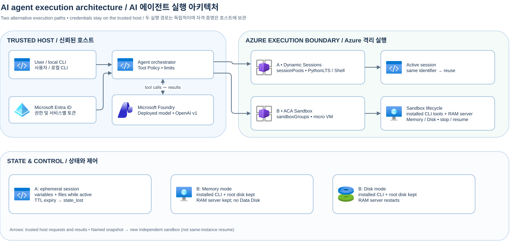
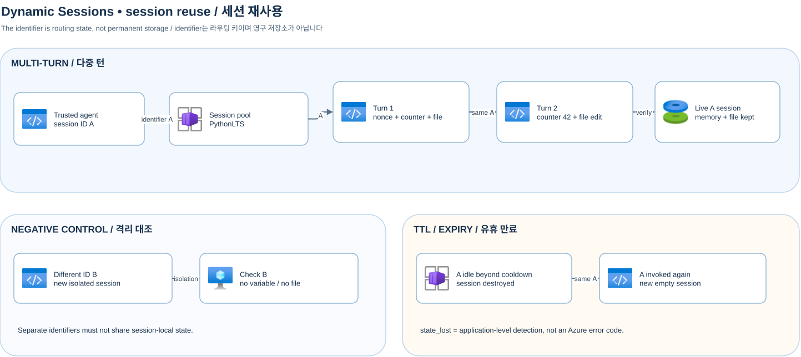

[한국어](./README.md)

# Azure Container Apps agent sandbox sample

Run model-generated code and commands in isolated execution environments. A trusted local Python CLI orchestrator validates Microsoft Foundry model tool calls and forwards them to the selected Azure execution path. This single-user sample requires additional security controls for service or multi-tenant use. Preview APIs and services can change. Documentation as of 2026-11-05.

## Architecture and selection



[Draw.io source](docs/assets/overall-architecture.drawio) · [Detailed architecture](docs/architecture-en.md)

| | Dynamic Sessions | ACA Sandbox |
| --- | --- | --- |
| Managed unit | `Microsoft.App/sessionPools` + `identifier` | `Microsoft.App/sandboxGroups` + sandbox ID |
| State | Variables and files while active; lost on expiry | Same-sandbox stop/resume and explicit snapshot clone |
| Isolation and execution | Pool-managed sessions; PythonLTS, optional Shell | Isolated micro VM; command execution and lifecycle control |
| Suitable for | Short interactive code execution | Resumable long-lived workspace and lifecycle comparison |

A and B are independent alternatives. Only model-backed examples require Foundry.

## Validation scope

The table below summarizes the results observed when running the six scenarios in Azure (as of 2026-11-05). See the [deployment, execution and cleanup How-To](docs/how-to-deploy-and-run-en.md) for step-by-step instructions.

| Actual live scenario | Observed result |
| --- | --- |
| Session reuse | counter 42, nonce/file preserved and other ID isolated; `state_lost` after 330 seconds ([details](docs/dynamic-sessions-en.md)) |
| Coding agent | creation, expected failing test and repaired test passed, model turns `[2,2,2]`, wall about 61.9 s |
| Shell | 2 runs with explicit cwd each time, wall about 5.0 s |
| Sandbox command agent | Real git/jq/sqlite3 and custom CLI installation, index-server calls, patch/verification after stop/resume without reinstallation ([details](docs/sandbox-en.md)) |
| Memory/Disk comparison | 3 samples each passed; installed CLI tools and files retained in both, RAM tool-server continuity only in Memory; mean worker-ready 421.253/938.684 ms ([full tables](docs/snapshot-comparison-en.md)) |
| Explicit snapshot clone | zero package reinstalls (`clone_provision_count=0`) + warm running RAM server cloned (`clone_ram_preserved_from_snapshot=true`) + clone's own Memory stop/resume and state isolation ([details](docs/sandbox-en.md)) |

After TTL expiry, the same ID is assigned a new empty session. Memory/Disk timings are client observations that include polling; Disk worker-ready includes restart. Check Cost Management for execution and snapshot charges.

## Prerequisites and configuration

Use Python 3.13 or later, PowerShell, Azure CLI, and an existing Foundry deployment supporting tool calling. Offline examples require no Azure login or resources and use fake adapters. The live paths require separate Azure resources and permissions. Python SDK `azure-containerapps-sandbox==0.1.0b4` is installed as a project dependency. The separate `aca` CLI is not required for these sandbox examples.

```powershell
py -3.13 -m venv .venv
.\.venv\Scripts\python.exe -m pip install -e ".[test]"
if (-not (Test-Path .env)) { Copy-Item .env.example .env }
.\scripts\preflight.ps1
```

Enter your own values only in `.env`; do not share or commit it. Set common `AZURE_SUBSCRIPTION_ID`, `AZURE_TENANT_ID`, `AZURE_LOCATION`, and settings for the chosen example. The loader rejects all `<...>` placeholders, including unused settings: clear unused values to empty strings. `FOUNDRY_OPENAI_BASE_URL` is an inference URL ending in `/openai/v1/`, not the project endpoint. Set `FOUNDRY_MODEL_DEPLOYMENT` to your actual deployment name. Dynamic Sessions needs `DYNAMIC_SESSIONS_RESOURCE_GROUP` and the actual pool's `DYNAMIC_SESSIONS_POOL_ENDPOINT`; Sandbox needs `SANDBOX_RESOURCE_GROUP` and `SANDBOX_GROUP_NAME`.

Before live execution sign in to Azure CLI with the correct tenant and subscription, and check the Foundry inference role (for example `Cognitive Services OpenAI User`), `Azure ContainerApps Session Executor` at pool scope, and `Container Apps SandboxGroup Data Owner` at sandbox group scope, respectively. Provisioning and role assignment need separate administrative permissions; propagation can take time. Actual Azure calls require both `ENABLE_LIVE_AZURE=true` in `.env` and `--live` on each example. Check cost, quota, and regional availability first. Calls are not automatically retried, to avoid duplicate execution.

## Part 1: Dynamic Sessions coding agent

[Detailed guide](docs/dynamic-sessions-en.md) · [Draw.io source](docs/assets/dynamic-sessions-session-reuse.drawio)



`infra/dynamic-sessions/main.bicep` and `scripts/setup-dynamic-sessions.ps1` deploy a PythonLTS pool. Replace the values below for your environment. The script can create the specified resource group and rejects protected Foundry groups. Setting the PowerShell environment variable is separate from editing `.env`.

```powershell
$env:ENABLE_PROVISIONING = 'true'
.\scripts\setup-dynamic-sessions.ps1 -SubscriptionId 'YOUR_SUBSCRIPTION_ID' -ResourceGroupName 'YOUR_DEMO_RESOURCE_GROUP' -PoolName 'YOUR_POOL_NAME' -Location 'YOUR_AZURE_REGION'
```

Copy the pool's returned `poolManagementEndpoint` into your private `.env` and grant the runtime role. Shell needs a separate `-ContainerType Shell` pool and its endpoint. The following are offline simulations by default.

```powershell
.\.venv\Scripts\python.exe examples\dynamic_sessions\session_reuse.py
.\.venv\Scripts\python.exe examples\dynamic_sessions\coding_agent.py
.\.venv\Scripts\python.exe examples\dynamic_sessions\shell_agent.py
```

The first verifies ID A's memory variables and file, isolation of ID B, and simulated expiry. The second verifies create → failing test → repair → passing test from actual tool results. The third sets the working directory for each Shell execution. For live examples append `--live` and enable the opt-in above. Run expiry separately using `session_reuse.py --live --wait-for-ttl SECONDS`, choosing a time sufficiently greater than the pool cooldown. Waiting may incur costs and a short wait fails. The sample returns `state_lost` when it detects session expiry.

## Part 2: Sandbox command execution and snapshots

[Detailed guide](docs/sandbox-en.md) · [Comparison experiment](docs/snapshot-comparison-en.md) · [Draw.io source](docs/assets/sandbox-memory-vs-disk-snapshot.drawio)


The external agent comprises a policy orchestrator on the trusted host and a remote Foundry model; inference and Azure credentials are not injected into the sandbox. Putting the orchestrator in the guest and injecting tokens would increase the risk of theft through untrusted code or prompt injection. Tool exposure and invocation have three stages:

1. The host prepares `git`, `jq`, `sqlite3`, a custom CLI and a loopback in-memory tool server in the sandbox.
2. The model uses the prompt's tool catalog to compose shell commands in a single `run_sandbox_command` function call.
3. The host validates the arguments, forwards the command through the SDK to its own sandbox, and returns the result to the model.

String checks require separate filesystem and egress controls to restrict working directories and shell commands. See the [detailed three-stage explanation](docs/sandbox-en.md#exposing-and-invoking-tools-for-an-external-agent-three-stages) for actual behavior and limitations.

Separate agent and sandbox update lifecycles allow compatible prompt, model and orchestration changes without recreating the sandbox. A golden snapshot containing installed CLIs and the server program can be reused for clones serving different agents, while an existing instance can be stopped and resumed. The sample’s `clone_provision_count=0` shows that the clone reused installed tools. Multi-agent connections require routing and authorization controls; guest tool or contract changes may require a snapshot update. [Design and limitations](docs/sandbox-en.md#decoupling-agent-and-sandbox-update-lifecycles)

`infra/sandbox/main.bicep` and `scripts/setup-sandbox.ps1` deploy a sandbox group in an existing demo resource group. The default is a dry run; actual deployment requires both `-Execute` and the PowerShell environment variable `ENABLE_PROVISIONING=true`.

```powershell
$env:ENABLE_PROVISIONING = 'true'
.\scripts\setup-sandbox.ps1 -SubscriptionId 'YOUR_SUBSCRIPTION_ID' -ResourceGroup 'YOUR_DEMO_RESOURCE_GROUP' -SandboxGroupName 'YOUR_SANDBOX_GROUP' -Location 'YOUR_AZURE_REGION'
# After reviewing the target and permissions, append -Execute to the same command
```

| Property | Memory | Disk |
| --- | --- | --- |
| Root disk | Preserved | Preserved |
| Installed external CLI tools (git/jq/sqlite3/agent-tool) | Preserved — no reinstallation | Preserved — no reinstallation |
| RAM and processes | Preserved after resume | Lost; VM and worker restart |
| Workload readiness | Verify the existing worker | Explicit post-resume bootstrap included |
| Data Disk volume | Unsupported when attached | Supported mode |

Resume latency is measured separately for Running, first exec and worker readiness. Consider the observed timings for each stage and revalidate external connections and tokens.

```powershell
.\.venv\Scripts\python.exe examples\sandbox\command_agent.py
.\.venv\Scripts\python.exe examples\sandbox\compare_snapshot_modes.py --iterations 3 --format markdown
.\.venv\Scripts\python.exe examples\sandbox\snapshot_clone.py
```

Runs are simulated by default. `command_agent.py --live` connects to Foundry for remote commands and stop/resume. The comparison uses `state_worker.py`’s RAM nonce/counter and disk SHA-256 oracle and reports stage timings. `--live` incurs actual costs; keep raw observations from `--output-dir` in a private directory. Clone creates a separate sandbox from a named snapshot and verifies independence from subsequent source changes.

## Tests, cleanup and public review

```powershell
.\.venv\Scripts\python.exe -m pytest
.\scripts\cleanup.ps1 -ManifestPath '.internal\runs\YOUR_RUN_MANIFEST.json'
# After checking the dry run, append -Execute to the same command
powershell -NoProfile -ExecutionPolicy Bypass -File .\scripts\check-public-readiness.ps1 -RequireDocs
```

Examples attempt to clean up sandboxes and snapshots they create; check the private recovery manifest on failure. Cleanup deletes only run-owned resources listed in the manifest and leaves groups and Foundry intact. Setup-created pools and groups are not automatically written to the manifest: separately identify and delete only your own resources in Azure. Check remaining snapshots, volumes, and storage costs. Independently inspect staged files and all history as well as Git ignore rules. [Security](SECURITY-en.md) · [Troubleshooting](docs/troubleshooting-en.md)

## Official documentation

- [Dynamic Sessions overview](https://learn.microsoft.com/en-us/azure/container-apps/sessions) · [Routing and authentication](https://learn.microsoft.com/en-us/azure/container-apps/sessions-usage) · [Code interpreter](https://learn.microsoft.com/en-us/azure/container-apps/sessions-code-interpreter) · [Shell](https://learn.microsoft.com/en-us/azure/container-apps/sessions-tutorial-shell)
- [Sandbox overview](https://learn.microsoft.com/en-us/azure/container-apps/sandboxes-overview) · [State and snapshots](https://learn.microsoft.com/en-us/azure/container-apps/sandboxes-snapshots-state-management) · [Python SDK](https://learn.microsoft.com/en-us/azure/container-apps/sandboxes-quickstart-python-sdk)
- [Foundry Entra authentication](https://learn.microsoft.com/en-us/azure/foundry-classic/openai/how-to/managed-identity) · [Azure icon terms](https://learn.microsoft.com/en-us/azure/architecture/icons/)
- [Sandbox developer documentation](https://sandboxes.azure.com/docs/sandboxes/snapshots) (no Korean-specific path). Some Korean Learn paths can also display English content.
