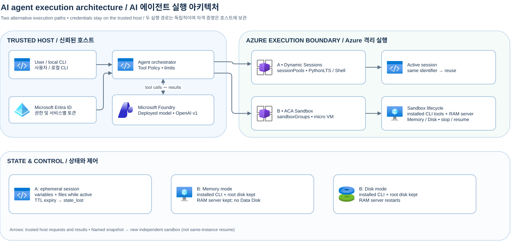
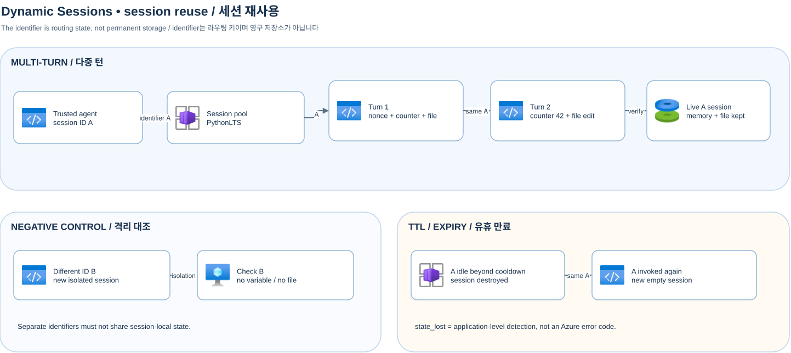

[English](./README-en.md)

# Azure Container Apps 에이전트 샌드박스 샘플

모델이 생성한 코드와 명령은 격리된 실행 환경에서 실행합니다. 로컬 Python CLI의 오케스트레이터가 Microsoft Foundry 배포 모델의 tool call을 검증하고 선택한 Azure 실행 경로로 전달합니다. 이 저장소는 단일 사용자용 샘플입니다. 서비스나 다중 테넌트 환경에는 별도의 보안 제어가 필요합니다. 미리 보기 API와 서비스는 변경될 수 있습니다. 설명 기준: 2026-11-05.

## 아키텍처와 선택



[Draw.io 원본](docs/assets/overall-architecture.drawio) · [상세 아키텍처](docs/architecture.md)

| | Dynamic Sessions | ACA Sandbox |
| --- | --- | --- |
| 관리 단위 | `Microsoft.App/sessionPools` + `identifier` | `Microsoft.App/sandboxGroups` + sandbox ID |
| 상태 | 활성 세션의 변수와 파일; 만료 후 소실 | 동일 sandbox의 stop/resume과 명시적 snapshot clone |
| 격리·실행 | 풀 관리 세션; PythonLTS, 선택 Shell | 격리된 마이크로 VM; 명령 실행 및 수명 주기 제어 |
| 적합한 작업 | 짧은 대화형 코드 실행 | 재개 가능한 장기 workspace와 수명 주기 비교 |

A와 B는 독립적인 대안입니다. 모델을 사용하는 예제만 Foundry가 필요합니다.

## 검증 범위

다음은 실제 Azure 환경(2026-11-05 기준)에서 6개 예제 시나리오를 실행해 확인한 요약 결과입니다. 전체 배포·실행·정리 절차는 [배포·실행·정리 How-To](docs/how-to-deploy-and-run.md)를 참조하세요.

| 실제 라이브 시나리오 | 확인된 결과 |
| --- | --- |
| 세션 재사용 | counter 42, nonce·파일 유지, 다른 ID 격리; 330초 대기 후 `state_lost` ([상세](docs/dynamic-sessions.md)) |
| 코딩 에이전트 | 생성·예상 테스트 실패·수정 테스트 통과, 모델 턴 `[2,2,2]`, wall 약 61.9초 |
| Shell | 2회 실행, 매번 cwd 명시, wall 약 5.0초 |
| Sandbox 명령 에이전트 | 실제 git/jq/sqlite3·전용 CLI 설치, 인덱스 도구 서버 호출, stop/resume 뒤 재설치 없는 패치·검증 ([상세](docs/sandbox.md)) |
| Memory/Disk 비교 | 각 3표본 통과; 설치된 CLI 도구·파일은 양쪽 보존, RAM 도구 서버는 Memory만 연속; worker 준비 평균 421.253/938.684ms ([전체 표](docs/snapshot-comparison.md)) |
| 명시적 snapshot clone | 패키지 재설치 0회(`clone_provision_count=0`) + 기동 중인 RAM 서버 즉시 복제(`clone_ram_preserved_from_snapshot=true`) + 복제본 자체 Memory stop/resume 및 상태 독립 ([상세](docs/sandbox.md)) |

TTL 만료 후 같은 ID에는 새 빈 세션이 할당됩니다. Memory/Disk 지연은 클라이언트와 polling을 포함한 관측값이며 Disk worker 준비에는 재기동이 포함됩니다. 실행과 스냅샷에 발생한 비용은 Cost Management에서 확인하세요.

## 준비와 환경 설정

Python 3.13 이상, PowerShell, Azure CLI와 기존 Foundry의 tool calling 지원 배포가 필요합니다. 오프라인 예제는 Azure 로그인·리소스가 필요 없으며 가짜 어댑터로 동작합니다. 두 라이브 경로는 별도 Azure 리소스와 권한이 필요합니다. Python SDK `azure-containerapps-sandbox==0.1.0b4`는 프로젝트 의존성으로 설치됩니다. Sandbox 실행에 별도 `aca` CLI는 필요하지 않습니다.

```powershell
py -3.13 -m venv .venv
.\.venv\Scripts\python.exe -m pip install -e ".[test]"
if (-not (Test-Path .env)) { Copy-Item .env.example .env }
.\scripts\preflight.ps1
```

`.env`에 자신의 값만 입력하고 공유하거나 커밋하지 마세요. 공통 `AZURE_SUBSCRIPTION_ID`, `AZURE_TENANT_ID`, `AZURE_LOCATION`과 해당 예제의 설정을 채우세요. 로더는 사용하지 않는 설정을 포함해 모든 `<...>` placeholder를 거부합니다. 사용하지 않는 값은 빈 문자열로 비우세요. `FOUNDRY_OPENAI_BASE_URL`은 `/openai/v1/`로 끝나는 추론 URL이며 프로젝트 엔드포인트와 다릅니다. `FOUNDRY_MODEL_DEPLOYMENT`에는 실제 배포 이름을 지정합니다. Dynamic Sessions에는 `DYNAMIC_SESSIONS_RESOURCE_GROUP`, 실제 풀의 `DYNAMIC_SESSIONS_POOL_ENDPOINT`, Sandbox에는 `SANDBOX_RESOURCE_GROUP`, `SANDBOX_GROUP_NAME`이 필요합니다.

라이브 실행 전 Azure CLI에 올바른 테넌트·구독으로 로그인하고, Foundry 추론 역할(예: `Cognitive Services OpenAI User`), 풀 범위의 `Azure ContainerApps Session Executor`, sandbox group 범위의 `Container Apps SandboxGroup Data Owner`를 각각 확인하세요. 프로비저닝과 역할 할당은 별도 관리 권한이 필요하며 전파가 지연될 수 있습니다. `.env`의 `ENABLE_LIVE_AZURE=true`와 각 예제의 `--live`를 둘 다 설정할 때만 실제 Azure를 호출합니다. 과금·할당량·리전 지원을 먼저 확인하세요. 자동 재시도로 중복 실행하지 않습니다.

## 파트 1: Dynamic Sessions 코딩 에이전트

[상세 가이드](docs/dynamic-sessions.md) · [Draw.io 원본](docs/assets/dynamic-sessions-session-reuse.drawio)



`infra/dynamic-sessions/main.bicep`와 `scripts/setup-dynamic-sessions.ps1`은 PythonLTS 풀을 배포합니다. 아래 값은 사용자 환경에 맞게 바꾸세요. 이 스크립트는 지정한 리소스 그룹을 생성할 수 있고 Foundry 보호 그룹을 거부합니다. PowerShell 환경 변수 설정은 `.env` 편집과 별개입니다.

```powershell
$env:ENABLE_PROVISIONING = 'true'
.\scripts\setup-dynamic-sessions.ps1 -SubscriptionId 'YOUR_SUBSCRIPTION_ID' -ResourceGroupName 'YOUR_DEMO_RESOURCE_GROUP' -PoolName 'YOUR_POOL_NAME' -Location 'YOUR_AZURE_REGION'
```

풀에서 반환한 `poolManagementEndpoint`를 비공개 `.env`에 복사하고 runtime 역할을 부여하세요. Shell은 별도 `-ContainerType Shell` 풀과 그 엔드포인트가 필요합니다. 아래는 기본 오프라인 시뮬레이션입니다.

```powershell
.\.venv\Scripts\python.exe examples\dynamic_sessions\session_reuse.py
.\.venv\Scripts\python.exe examples\dynamic_sessions\coding_agent.py
.\.venv\Scripts\python.exe examples\dynamic_sessions\shell_agent.py
```

첫 예제는 ID A의 메모리 변수·파일 유지와 ID B의 격리, 시뮬레이션된 만료를 검증합니다. 두 번째는 생성 → 실패 테스트 → 수정 → 통과 테스트를 실제 도구 결과로 확인합니다. 세 번째는 각 Shell 실행마다 작업 디렉터리를 명시합니다. 라이브 예제는 각 명령 뒤에 `--live`를 붙이고 앞의 opt-in을 설정하세요. 만료 실험은 풀 cooldown보다 충분히 긴 시간을 정해 `session_reuse.py --live --wait-for-ttl SECONDS`로 별도 실행합니다. 대기 중 비용이 발생할 수 있으며 짧으면 실패합니다. `state_lost`는 세션 만료를 감지했을 때 샘플이 반환하는 상태값입니다.

## 파트 2: Sandbox 명령 실행과 스냅샷

[상세 가이드](docs/sandbox.md) · [비교 실험](docs/snapshot-comparison.md) · [Draw.io 원본](docs/assets/sandbox-memory-vs-disk-snapshot.drawio)


외부 에이전트는 신뢰된 호스트의 정책 오케스트레이터와 원격 Foundry 모델로 구성되며, 추론·Azure 자격 증명을 sandbox에 주입하지 않습니다. 게스트에 오케스트레이터를 두고 토큰을 주입하면 비신뢰 코드나 프롬프트 인젝션에 의한 탈취 위험이 커지기 때문입니다. 도구 노출과 호출은 세 단계입니다.

1. 호스트가 sandbox에 `git`, `jq`, `sqlite3`, 전용 CLI와 루프백 인메모리 도구 서버를 준비합니다.
2. 모델은 프롬프트의 도구 목록을 보고 단일 `run_sandbox_command` 함수 호출에 셸 명령을 담습니다.
3. 호스트가 인자를 검증하고 자신이 소유한 sandbox에 SDK로 명령을 전달한 뒤 결과를 모델에 돌려줍니다.

문자열 검사는 허용된 작업 디렉터리와 셸 명령을 완전히 격리하지 못하므로 별도의 파일시스템 및 egress 제어가 필요합니다. 실제 동작과 제약은 [3단계 상세 설명](docs/sandbox.md#외부-에이전트의-도구-노출과-호출-3단계)을 참조하세요.

에이전트와 sandbox의 변경 수명 주기를 분리하면 도구 계약이 호환되는 프롬프트·모델·오케스트레이션 변경에 sandbox 재생성이 필요하지 않습니다. 설치된 CLI와 서버 프로그램을 담은 골든 스냅샷으로 다른 용도의 sandbox를 clone하고 기존 인스턴스는 stop/resume할 수 있습니다. 샘플의 `clone_provision_count=0`은 clone이 설치된 도구를 재사용했음을 보여 줍니다. 다중 에이전트 연결에는 라우팅과 권한 제어가 필요하며 게스트 도구나 계약 변경에는 스냅샷 갱신이 필요할 수 있습니다. [설계 및 제약](docs/sandbox.md#에이전트와-sandbox-변경-수명-주기-분리)

`infra/sandbox/main.bicep`와 `scripts/setup-sandbox.ps1`은 기존 데모 리소스 그룹에 sandbox group을 배포합니다. 기본 실행은 dry run이며 실제 배포에는 `-Execute`와 PowerShell 환경 변수 `ENABLE_PROVISIONING=true`가 모두 필요합니다.

```powershell
$env:ENABLE_PROVISIONING = 'true'
.\scripts\setup-sandbox.ps1 -SubscriptionId 'YOUR_SUBSCRIPTION_ID' -ResourceGroup 'YOUR_DEMO_RESOURCE_GROUP' -SandboxGroupName 'YOUR_SANDBOX_GROUP' -Location 'YOUR_AZURE_REGION'
# 대상과 권한을 확인한 후 동일 명령에 -Execute 추가
```

| 속성 | Memory | Disk |
| --- | --- | --- |
| 루트 디스크 | 보존 | 보존 |
| 설치된 외부 CLI 도구 (git/jq/sqlite3/agent-tool) | 보존 — 재설치 불필요 | 보존 — 재설치 불필요 |
| RAM·프로세스 | 재개 후 유지 | 소실; VM 및 워커 재기동 |
| 워크로드 준비 | 기존 워커 확인 | 재개 후 명시적 bootstrap 포함 |
| Data Disk 볼륨 | 연결 시 미지원 | 지원되는 모드 |

재개 지연은 Running 확인, 첫 exec, 워커 준비의 서로 다른 단계로 측정합니다. 각 단계의 관측값과 외부 연결·토큰의 재검증을 함께 고려하세요.

```powershell
.\.venv\Scripts\python.exe examples\sandbox\command_agent.py
.\.venv\Scripts\python.exe examples\sandbox\compare_snapshot_modes.py --iterations 3 --format markdown
.\.venv\Scripts\python.exe examples\sandbox\snapshot_clone.py
```

기본 실행은 모의 결과입니다. `command_agent.py --live`는 Foundry와 연결해 원격 명령과 stop/resume을 수행합니다. 비교 예제는 `state_worker.py`의 RAM nonce·카운터와 디스크 SHA-256을 비교하고 단계별 시간을 보고합니다. `--live`는 실제 비용을 발생시키며 `--output-dir`은 민감한 원시 관찰을 비공개 경로에 저장해야 합니다. clone은 named snapshot에서 별도 sandbox를 생성하고 원본 변경으로부터 독립성을 검증합니다.

## 테스트, 정리 및 공개 검토

```powershell
.\.venv\Scripts\python.exe -m pytest
.\scripts\cleanup.ps1 -ManifestPath '.internal\runs\YOUR_RUN_MANIFEST.json'
# dry run 확인 후 같은 명령에 -Execute 추가
powershell -NoProfile -ExecutionPolicy Bypass -File .\scripts\check-public-readiness.ps1 -RequireDocs
```

예제는 자신이 만든 sandbox와 snapshot을 정리하려고 시도합니다. 실패 시 비공개 recovery manifest를 확인하세요. cleanup은 명시된 manifest의 run 소유 리소스만 삭제하고 그룹·Foundry를 유지합니다. setup 스크립트의 풀·그룹은 자동 manifest에 기록되지 않으므로 자신이 만든 리소스만 Azure에서 별도 확인·삭제하세요. 남은 snapshot·volume·스토리지 비용도 확인하세요. Git ignore와 별도로 스테이징 파일과 전체 이력을 검사합니다. [보안 안내](SECURITY.md) · [문제 해결](docs/troubleshooting.md)

## 공식 문서

- [Dynamic Sessions 개요](https://learn.microsoft.com/ko-kr/azure/container-apps/sessions) · [라우팅과 인증](https://learn.microsoft.com/ko-kr/azure/container-apps/sessions-usage) · [코드 인터프리터](https://learn.microsoft.com/ko-kr/azure/container-apps/sessions-code-interpreter) · [Shell](https://learn.microsoft.com/ko-kr/azure/container-apps/sessions-tutorial-shell)
- [Sandbox 개요](https://learn.microsoft.com/ko-kr/azure/container-apps/sandboxes-overview) · [상태와 스냅샷](https://learn.microsoft.com/ko-kr/azure/container-apps/sandboxes-snapshots-state-management) · [Python SDK](https://learn.microsoft.com/ko-kr/azure/container-apps/sandboxes-quickstart-python-sdk)
- [Foundry Entra 인증](https://learn.microsoft.com/ko-kr/azure/foundry-classic/openai/how-to/managed-identity) · [Azure 아이콘 사용 조건](https://learn.microsoft.com/ko-kr/azure/architecture/icons/)
- [Sandbox 개발자 문서](https://sandboxes.azure.com/docs/sandboxes/snapshots) (한국어 전용 경로 없음). 일부 Learn 한국어 경로도 영어로 표시될 수 있습니다.
