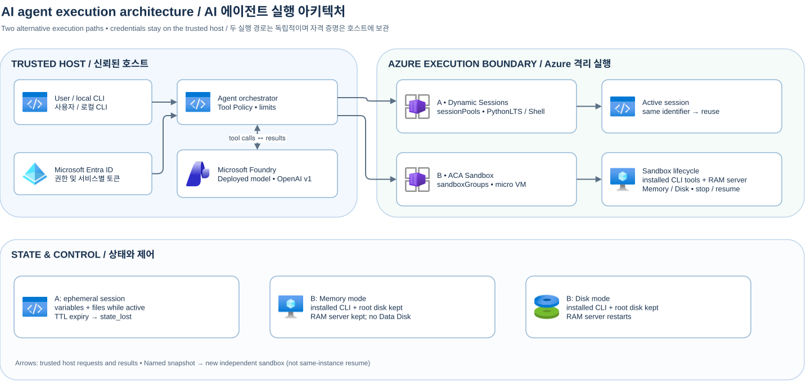

[한국어](./architecture.md)

# Architecture and trust boundaries

[Editable Draw.io source](assets/overall-architecture.drawio) · [README](../README-en.md) · [Deployment, execution and cleanup How-To](how-to-deploy-and-run-en.md)

The user and local CLI orchestrator and tool policy form the trusted area. The Foundry OpenAI v1 deployed model proposes code but does not choose endpoints, credentials, user ownership, or sessions. The policy limits allowed tools, arguments, turns, time, and output. Model output and tool results are untrusted and are not executed in a host subprocess. The host obtains the appropriate Entra tokens for each service without injecting them into the sandbox.

## Why separate the brain from execution?

In this sample the brain comprises the policy orchestrator on the trusted host and the remote Foundry model. The host manages inference and Azure tokens and validates model decisions. Running the orchestrator inside the sandbox could require injecting inference tokens or Azure credentials into the guest, increasing the risk of theft through untrusted code execution or prompt injection. The host manages credentials; the isolated micro VM holds the CLIs and loopback in-memory server needed for tool execution.

Instead of registering each installed tool as a model function, the host supplies a tool catalog in the prompt and a single `run_sandbox_command` gateway. Model-proposed shell commands pass through host policy validation to the host-owned sandbox, and results are returned to the model. The policy's string checks do not provide complete command isolation, so credential separation, egress and resource restrictions, and other defenses remain necessary. [Detailed three-stage flow](sandbox-en.md#exposing-and-invoking-tools-for-an-external-agent-three-stages)

### Decoupling agent and sandbox update lifecycles

A design that bakes prompts, orchestration logic, model version, and business rules into an image or snapshot tightly couples them: changes require updating and redeploying that image or snapshot. This sample separates agent configuration from general guest tools (`git`, `jq`, `sqlite3`, repository auditing and indexing). As long as tool interfaces and compatibility remain stable, replacing the model (for example `gpt-5.4-mini` → `gpt-5.4`), changing prompts or host logic, or adding roles such as code review, security audit, or patching can happen without recreating the sandbox image or snapshot. Separately verify tool-calling support and access for the target model.

A reusable golden snapshot containing installed CLIs and the server program can serve as the basis for sandbox clones used by different agents, while an existing sandbox can be stopped and resumed. `clone_provision_count=0` in the public clone example shows that the new clone reused installed tools. Connecting multiple agents requires separate routing, ownership, and security controls; tool, guest configuration, or interface changes may require updating the snapshot.

### Three patterns for agent placement and authentication in ACA Sandbox

Depending on where you place the agent (the LLM orchestration loop) and how you handle upstream model API credentials, ACA Sandbox architectures fall into three patterns.

| Architecture pattern | Agent (LLM loop) location | Credential / token location | How it works and when to use it |
| :--- | :--- | :--- | :--- |
| **Pattern 1: External agent + in-sandbox general tools** *(this sample repository)* | Host (external backend) | Host only (sandbox receives inbound `exec` calls) | - The host calls the model and remotely executes general-purpose CLIs and a local tool server inside the sandbox. - Works even when sandbox outbound network (egress) is blocked, and changing agent prompts or models does not require rebuilding sandbox images or snapshots. |
| **Pattern 2: Built-in agent presets (`copilot` / `claude`) + Provider Credentials** | Inside the sandbox | Stored on the Sandbox Group and injected into the guest at boot (`ANTHROPIC_API_KEY`, etc.) | - Uses the platform's prebuilt `copilot` (GitHub Copilot CLI) or `claude` (Claude Code CLI) disk images alongside Sandbox Group AI Provider Credentials (fine-grained PAT `github_pat_...` or `sk-ant-...` key). - Convenient for quickly launching off-the-shelf coding agent CLIs, though the token is loaded into the guest runtime and rotating a token requires restarting running sandboxes. |
| **Pattern 3: In-sandbox agent + Egress Proxy `Transform` header injection** | Inside the sandbox | Egress Proxy outside the guest (`secretRef` / `managedIdentityRef`) | - Runs the agent process inside the sandbox while keeping API keys (Sandbox Group Secrets) and Managed Identity tokens out of guest environment variables. - When in-sandbox code calls an upstream LLM API, the Egress Proxy outside the guest injects the `Authorization` header via a `Transform` rule, keeping raw credential values hidden from code inside the sandbox. ([Egress policy details](https://learn.microsoft.com/en-us/azure/container-apps/sandboxes-egress-policies)) |

## Comparing Dynamic Sessions and ACA Sandbox: trade-offs

Dynamic Sessions routes an `identifier` to a PythonLTS or Shell session in `Microsoft.App/sessionPools`. Because the caller only needs to pass an `identifier` string while the session pool automatically handles allocation, routing, and idle cleanup, host implementation is very simple. In exchange, sessions cannot be manually stopped and resumed on demand or cloned from snapshots, and state is discarded once the idle cooldown expires.

ACA Sandbox creates an isolated micro VM in `Microsoft.App/sandboxGroups` and controls exec, stop, resume, snapshot, clone, and deletion through the SDK. It provides high flexibility: you can install an external CLI toolchain (`git`, `jq`, `sqlite3`, `agent-tool`, `repo-audit`) and a loopback repository-index server (`state_worker.py`), stop and resume at will in `Memory` (RAM + disk) or `Disk` mode, and clone pre-warmed snapshots. In exchange, the customer (host backend) must implement `sandbox_id` mapping per agent/user request and orchestrate the `stop`/`resume`/`delete` lifecycle. [Dynamic Sessions guide](dynamic-sessions-en.md) · [Sandbox guide](sandbox-en.md) · [State oracle](snapshot-comparison-en.md)

## Operational boundary

Before exposing the sample as a service, implement user authentication and session ownership, egress, resource and budget limits, and audit and data retention policies. Validate ownership alongside the session ID. Memory snapshots can contain sensitive RAM; revalidate external system state and connections. Do not delete existing Foundry or other users’ resources during cleanup.

The diagrams were exported with Draw.io 32.6.1 and embed graphics from its Azure icon library. Where there is no dedicated Container Apps icon, the parent Container Apps Environment icon and an explicit label are used. [Azure official icon source and terms](https://learn.microsoft.com/en-us/azure/architecture/icons/).
