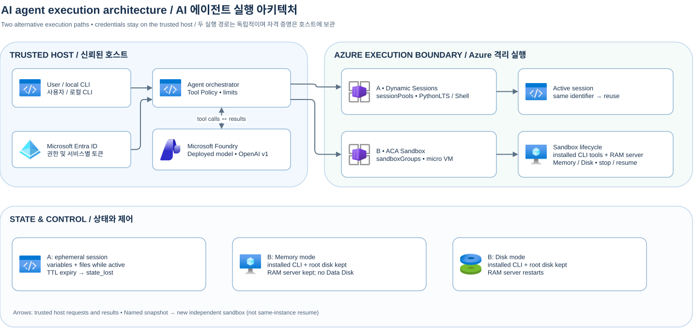

[English](./architecture-en.md)

# 아키텍처와 신뢰 경계

[편집 가능한 Draw.io 원본](assets/overall-architecture.drawio) · [README](../README.md) · [배포·실행·정리 How-To](how-to-deploy-and-run.md)

사용자와 로컬 CLI의 오케스트레이터·도구 정책은 신뢰 영역에 있습니다. Foundry OpenAI v1 배포 모델은 코드를 제안하지만 endpoint, 자격 증명, 사용자 소유권이나 세션을 선택하지 않습니다. 정책은 허용 도구·인자·횟수·시간·출력을 제한합니다. 모델 출력과 도구 결과는 비신뢰 데이터이며 호스트 subprocess로 실행하지 않습니다. 각각의 서비스에 적절한 Entra 토큰을 호스트에서 취득하고 샌드박스에 주입하지 않습니다.

## 대안 A / B

A는 `Microsoft.App/sessionPools`의 PythonLTS 세션으로 요청 `identifier`를 라우팅합니다. 동일 활성 ID의 인터프리터와 파일은 재사용되지만 유휴 만료 후 보장되지 않습니다. Shell은 별도 선택 풀입니다. B는 `Microsoft.App/sandboxGroups`의 격리된 마이크로 VM을 만들고 SDK로 exec·stop·resume·삭제를 제어합니다. 샌드박스 내부에 에이전트 CLI 툴체인(`git`, `jq`, `sqlite3`, `agent-tool`·`repo-audit` 등 커스텀 CLI)과 루프백 리포지토리 인덱스 도구 서버(`state_worker.py`)를 설치·제어합니다. Memory는 RAM과 루트 디스크를 보존하고, Disk는 설치 도구와 루트 디스크를 보존하지만 서버 프로세스는 재시작합니다. named snapshot에서 새 clone을 만드는 것은 기존 인스턴스 재개와 다릅니다. [A 가이드](dynamic-sessions.md) · [B 가이드](sandbox.md) · [상태 오라클](snapshot-comparison.md)

## 운영 경계

이 코드는 인증된 다중 사용자용 서비스가 아닙니다. 서비스로 공개하려면 사용자 인증과 세션 소유권, egress, 예산·자원 제한, 감사·데이터 보존 정책을 별도로 구현해야 합니다. 세션 ID만으로 권한을 판정하지 마세요. Sandbox 메모리 스냅샷에도 민감한 RAM이 포함될 수 있고 외부 시스템 상태·연결 일관성은 보장되지 않습니다. 정리 시 기존 Foundry나 다른 사용자의 리소스를 삭제하지 마세요.

다이어그램은 Draw.io 32.6.1에서 내보냈으며 해당 프로그램의 Azure 아이콘 라이브러리 그래픽을 내장합니다. Container Apps에 전용 아이콘이 없는 경우 Container Apps Environment 상위 아이콘과 명시적 라벨을 사용합니다. [Azure 공식 아이콘 출처와 이용 조건](https://learn.microsoft.com/ko-kr/azure/architecture/icons/).
