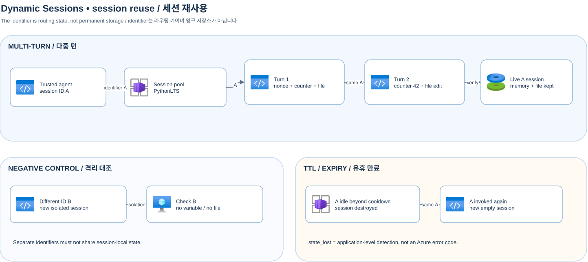

[한국어](./dynamic-sessions.md)

# Dynamic Sessions: coding agent and ID reuse



[Draw.io source](assets/dynamic-sessions-session-reuse.drawio) · [README and setup](../README-en.md)

`PythonLTS` is a code interpreter; the local agent handles model calls, tool policy, and result delivery. The pool routes the same `identifier` to the same active session. Check that A’s nonce, counter and file survive the next turn and that B has neither variable nor file. After expiry the same ID can allocate a new empty session. The example returns `state_lost` when it detects session expiry. Validate user ownership alongside the identifier.

```powershell
.\.venv\Scripts\python.exe examples\dynamic_sessions\session_reuse.py
.\.venv\Scripts\python.exe examples\dynamic_sessions\coding_agent.py
.\.venv\Scripts\python.exe examples\dynamic_sessions\shell_agent.py
```

The default uses fake clients. Live runs require both `--live` and `ENABLE_LIVE_AZURE=true` after README configuration and RBAC setup. `session_reuse.py --live --wait-for-ttl SECONDS` waits before checking actual expiry. The example’s `--session-id` passes an explicit ID. Plan separately for session expiry and process failure between CLI invocations. Treat identifiers as private. The `--wire-profile` default is `containerapp-1.3.0b5`; `learn-properties` is an alternative profile. Check the supported default in configuration and actual service contract; do not retry failed calls automatically.

The Shell example uses a separate Shell pool; because each execution runs in a new shell process, specify `cd /mnt/data` and required environment variables on every execution. Provision the pool with `infra/dynamic-sessions/main.bicep` and `scripts/setup-dynamic-sessions.ps1`, and use the endpoint returned by the pool. Deployment, execution and TTL waiting may incur costs.

[Routing and authentication](https://learn.microsoft.com/en-us/azure/container-apps/sessions-usage) · [Code interpreter API](https://learn.microsoft.com/en-us/azure/container-apps/sessions-code-interpreter) · [Shell](https://learn.microsoft.com/en-us/azure/container-apps/sessions-tutorial-shell)

## Observed Azure results and interpretation (2026-11-05)

After setup in the [deployment, execution and cleanup How-To](how-to-deploy-and-run-en.md), `session_reuse.py --live` returned the following, with the identifier redacted:

```json
{"mode":"live","session":"[REDACTED]","reuse":"passed","counter":42,"nonce_preserved":true,"original_sha256":"ba1a531f581d2e6094e978ed6f7aca7a8d92eeb62c6e7ad73ee692f7f18bc772","file_modified":true,"negative_control":"passed","expiry":"skipped: use --live --wait-for-ttl after choosing the pool cooldown"}
```

The same active `identifier` retained the RAM nonce and counter and the `/mnt/data` file; the counter advanced to 42. A different ID’s negative control found neither variable nor file. The changed file hash was also verified.

`session_reuse.py --live --wait-for-ttl 330` returned:

```json
{"mode":"live","session":"[REDACTED]","reuse":"passed","counter":42,"nonce_preserved":true,"original_sha256":"ba1a531f581d2e6094e978ed6f7aca7a8d92eeb62c6e7ad73ee692f7f18bc772","file_modified":true,"negative_control":"passed","expiry":"state_lost"}
```

After 330 seconds without requests for the ID on a 300-second cooldown pool, the same ID had no variable and file GET returned 404. The session expired and a new empty session was allocated for the same string. The default run skips TTL.

`coding_agent.py --live` and `shell_agent.py --live` returned:

```json
{"mode":"live","session":"[REDACTED]","creation":"passed","initial_test":"failed_as_expected","repair_test":"passed","model_turns":[2,2,2]}
{"mode":"live","session":"[REDACTED]","runs":2,"cwd_explicit_each_time":true}
```

The `gpt-5.4-mini` model handled three user turns: create → failing test → repair/retest. Each turn’s tool call and final response gave `model_turns=[2,2,2]`. An uncaught assertion produced remote `Failed` before the repaired test passed. The measured example-main wall was about 61.9 s for coding and 5.0 s for Shell. Separate host marker checks are excluded from `model_turns`.

The actual Shell preview request body accepts only `{shellCommand, timeoutInSeconds}`, and `status="0"` is a string process exit code (0 means success). This differs from Python execution response semantics. Each Shell execution sets cwd explicitly. Nested files required the basename in the URL route and the directory in the `path=` query. See [troubleshooting](troubleshooting-en.md) for the observed errors and Windows URL handling.

Host-observed HTTP and Azure CLI credential round trips can take seconds, whereas container `executionTimeInMilliseconds` was 6–16 ms for creation/marker/modification (a separate uncaught assertion took 325 ms). Example-main wall includes model, network and cleanup, and excludes process initialization and prior imports.