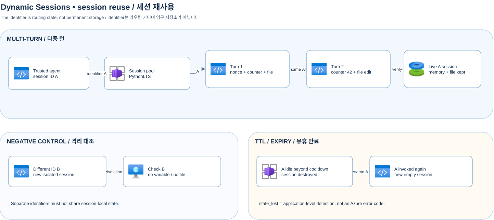

[English](./dynamic-sessions-en.md)

# Dynamic Sessions: 코딩 에이전트와 세션 ID 재사용



[Draw.io 원본](assets/dynamic-sessions-session-reuse.drawio) · [README와 설정](../README.md) · [배포·실행·정리 How-To](how-to-deploy-and-run.md)

`PythonLTS`는 코드 인터프리터이며 호스트의 오케스트레이터가 모델 호출, 도구 정책 및 결과 전달을 관리합니다. 세션 풀은 동일한 `identifier`(세션 ID)를 같은 활성 컨테이너로 라우팅하고, 다른 `identifier`는 별도의 격리된 컨테이너로 라우팅합니다. 유휴 시간(`cooldownPeriodInSeconds`)이 지나 세션이 만료된 뒤 같은 `identifier`로 요청하면 새로운 빈 세션이 할당되며, 샘플은 이를 감지해 `state_lost` 상태를 반환합니다.

## 실행 방법 (원클릭 실행 스크립트 및 개별 스크립트)

루트의 `run-demo.ps1`을 사용하면 시나리오 1~3을 단계별 설명 출력과 함께 바로 실행할 수 있으며(`.env`의 `ENABLE_LIVE_AZURE=true` 여부에 따라 라이브 또는 오프라인 시뮬레이션으로 자동 동작), 개별 Python 스크립트를 직접 실행할 수도 있습니다.

```powershell
# 통합 스크립트 실행 (시나리오 1 ~ 3)
.\run-demo.ps1 1
.\run-demo.ps1 2
.\run-demo.ps1 3

# 개별 Python 예제 스크립트 직접 실행 (오프라인 기본, 라이브는 --live 추가)
.\.venv\Scripts\python.exe examples\dynamic_sessions\session_reuse.py
.\.venv\Scripts\python.exe examples\dynamic_sessions\coding_agent.py
.\.venv\Scripts\python.exe examples\dynamic_sessions\shell_agent.py
```

라이브 실행은 `.env` 설정 및 RBAC 부여 후 `ENABLE_LIVE_AZURE=true`와 `--live`를 함께 사용합니다. `session_reuse.py`는 단일 실행에서 4단계 전체를 순서대로 검증하는 기본 모드(`--step all`) 외에, 서로 다른 CLI 프로세스에서 명시적 `--session-id`로 세션을 이어 쓰거나 격리를 대조하는 단계별 실행(`--step init`, `--step reuse`, `--step check`)도 지원합니다.

```powershell
# 개별 CLI 호출로 동일 세션 ID(my-session-a) 재사용 vs 다른 세션 ID(other-session-b) 격리 직접 확인
.\.venv\Scripts\python.exe examples\dynamic_sessions\session_reuse.py --live --session-id my-session-a --step init
.\.venv\Scripts\python.exe examples\dynamic_sessions\session_reuse.py --live --session-id my-session-a --step reuse
.\.venv\Scripts\python.exe examples\dynamic_sessions\session_reuse.py --live --session-id my-session-a --step reuse
.\.venv\Scripts\python.exe examples\dynamic_sessions\session_reuse.py --live --session-id other-session-b --step check
```

[라우팅과 인증](https://learn.microsoft.com/ko-kr/azure/container-apps/sessions-usage) · [코드 인터프리터 API](https://learn.microsoft.com/ko-kr/azure/container-apps/sessions-code-interpreter) · [Shell](https://learn.microsoft.com/ko-kr/azure/container-apps/sessions-tutorial-shell)

---

## 시나리오 1: Session ID 재사용(`100 → 101 → 102`) vs. 다른 Session ID 격리 (`session_reuse.py`)

### 실행 출력 (`.\run-demo.ps1 1` / `session_reuse.py --live`)

```json
{
  "step": "init",
  "session_id": "session-a-453",
  "turn_counter": 100,
  "nonce": "277ec8756f82316aee18838004684924",
  "file_created": "/mnt/data/agent-demo/source.py"
}
{
  "step": "reuse",
  "session_id": "session-a-453",
  "variable_preserved": true,
  "turn_counter": 101,
  "nonce": "277ec8756f82316aee18838004684924",
  "file_content": "def add(a, b):\n    return a + b\n"
}
{
  "step": "reuse",
  "session_id": "session-a-453",
  "variable_preserved": true,
  "turn_counter": 102,
  "nonce": "277ec8756f82316aee18838004684924",
  "file_content": "def add(a, b):\n    return a + b\n"
}
{
  "step": "check",
  "session_id": "session-b-453",
  "variable_exists": false,
  "turn_counter": null,
  "file_exists": false
}
```

단일 명령(`session_reuse.py --live`)으로 실행했을 때의 최종 요약 JSON은 다음과 같습니다:

```json
{"mode":"live","session":"[REDACTED]","other_session":"[REDACTED]","reuse":"passed","counter_progression":[100,101,102],"counter":102,"nonce_preserved":true,"original_sha256":"ba1a531f581d2e6094e978ed6f7aca7a8d92eeb62c6e7ad73ee692f7f18bc772","file_modified":true,"other_session_isolated":{"variable_exists":false,"turn_counter":null,"file_exists":false},"negative_control":"passed","expiry":"skipped: use --live --wait-for-ttl after choosing the pool cooldown"}
```

### 결과 해석
- **동일 `session_id` 연속 재호출 (`100 → 101 → 102`)**: `[1-1]`에서 `Session A`의 Python 인터프리터 메모리에 `turn_counter = 100`, 난수 `nonce`를 설정하고 `/mnt/data/agent-demo/source.py` 파일을 생성했습니다. 이후 `[1-2]`, `[1-3]`에서 동일한 `session_id`로 재호출하면 같은 활성 컨테이너로 라우팅되므로 파일이나 외부 DB에서 상태를 다시 읽지 않아도 메모리의 `turn_counter`가 `101`, `102`로 이어서 증가하고 파일도 그대로 유지됩니다.
- **다른 `session_id` 호출 시 완전 격리 (`variable_exists: false`, `file_exists: false`)**: `[1-4]`에서 다른 식별자인 `Session B`로 호출하면 별도의 Hyper-V 격리 세션으로 라우팅되어 `Session A`의 메모리 변수(`turn_counter: null`)와 파일(`file_exists: false`, 다운로드 시 404)에 접근할 수 없습니다.
- **TTL 만료 후 재호출 (`--wait-for-ttl 330`)**: 300초 cooldown 풀에서 330초 동안 유휴 대기한 뒤 같은 `session_id`로 다시 호출하면 기존 컨테이너가 파기되고 새 빈 세션이 할당되어 `expiry: "state_lost"`로 감지됩니다.

---

## 시나리오 2: Foundry LLM 연동 다중 턴 코딩 에이전트 (`coding_agent.py`)

### 동작 구조 및 코드 수정 위치
- 실제 Foundry 배포 모델(`gpt-5.4-mini`)이 동일한 `session_id` 안에서 3턴에 걸쳐 **① 버그 코드 작성 → ② 테스트 실행 및 실제 `AssertionError` 실패 관찰 → ③ 코드 패치 및 테스트 통과**를 수행합니다.
- 모델에 노출되는 도구 스키마(`src/aca_agent_sample/dynamic_sessions/coding_agent.py`의 `execute_python`, `upload_text_file`, `read_text_file`, `list_session_files`)에는 `session_id`나 `endpoint` 필드가 없으며, 호스트가 현재 대화의 `session_id`를 강제로 바인딩합니다.
- 다른 코딩 과제로 변경해 테스트하려면 `examples/dynamic_sessions/coding_agent.py`의 `prompts` 리스트와 호스트 검증 함수(`verify_turn_one` ~ `verify_turn_three`)를 수정하면 됩니다.

### 실행 출력 (`.\run-demo.ps1 2` / `coding_agent.py --live`)

```text
[coding-agent] === Turn 1/3 (Session [REDACTED]) ===
[coding-agent] Tool Result (execute_python): status=succeeded, stdout='set globals', stderr=''
[coding-agent] Tool Result (upload_text_file): status=succeeded, stdout='File uploaded', stderr=''
[coding-agent] Current /mnt/data/agent-demo/add.py in session:
def add(a, b):
    return a - b

[coding-agent] === Turn 2/3 (Session [REDACTED]) ===
[coding-agent] Tool Result (execute_python): status=failed, stdout='', stderr="... ----> 5 assert add(2,3)==5\nAssertionError:"
[coding-agent] Current /mnt/data/agent-demo/add.py in session:
def add(a, b):
    return a - b

[coding-agent] === Turn 3/3 (Session [REDACTED]) ===
[coding-agent] Tool Result (execute_python): status=succeeded, stdout='TEST PASSED', stderr=''
[coding-agent] Current /mnt/data/agent-demo/add.py in session:
def add(a, b):
    return a + b
```

```json
{"mode":"live","session":"[REDACTED]","creation":"passed","initial_test":"failed_as_expected","repair_test":"passed","model_turns":[3,2,2]}
```

### 결과 해석
- **Turn 1 (버그 코드 생성 및 호스트 검증)**: 모델이 세션 메모리에 `turn_counter = 1`, `session_nonce = 'demo-nonce'`를 설정하고 `/mnt/data/agent-demo/add.py`에 `return a - b`를 작성합니다. 호스트는 AST 파싱과 프로브 실행을 통해 파일과 변수가 실제로 생성되었는지 검증합니다.
- **Turn 2 (동일 세션에서 실패 관찰)**: 모델이 같은 세션에서 `turn_counter`를 `2`로 증가시키고 `assert add(2, 3) == 5`를 실행해 원격 컨테이너로부터 실제 `AssertionError`를 반환받습니다. 호스트는 트레이스백의 예외 타입이 정확히 `AssertionError`인지 확인합니다.
- **Turn 3 (코드 패치 및 호스트 재검증)**: 모델이 `/mnt/data/agent-demo/add.py`를 `return a + b`로 수정한 뒤 테스트를 통과시킵니다. 마지막으로 호스트가 직접 디스크의 `add.py`를 다시 로드해 `add(2, 3) == 5` 및 `add(10, -4) == 6`을 독립 검증합니다.

---

## 시나리오 3: Shell 세션 풀 명령 실행 (`shell_agent.py`)

### 실행 방법 및 출력 (`.\run-demo.ps1 3` / `shell_agent.py --live`)

`Shell` 예제는 `ContainerType=Shell`로 생성된 별도 세션 풀 엔드포인트를 사용합니다. `.\run-demo.ps1 3`은 리소스 그룹에서 Shell 세션 풀 엔드포인트를 자동으로 조회해 임시 환경 변수로 연결한 뒤 실행하고 원래 설정으로 복원합니다.

```text
[shell-agent] Run 1/2 (Session [REDACTED]): $ cd /mnt/data && mkdir -p shell-demo && echo 'hello-from-shell-session' > shell-demo/note.txt && pwd
[shell-agent] Run 1/2 stdout:
/mnt/data
[shell-agent] Run 2/2 (Session [REDACTED]): $ cd /mnt/data && cat shell-demo/note.txt && pwd
[shell-agent] Run 2/2 stdout:
hello-from-shell-session
/mnt/data
```

```json
{"mode":"live","session":"[REDACTED]","runs":2,"cwd_explicit_each_time":true}
```

### 결과 해석
- **세션 내 파일 유지와 프로세스 특성**: Run 1에서 생성한 `/mnt/data/shell-demo/note.txt`는 동일한 `session_id`를 사용하는 Run 2에서 그대로 읽힙니다. 다만 각 `execute_shell` 호출은 새로운 셸 서브프로세스에서 실행되므로 이전 호출의 `cd`나 `export` 상태에 의존하지 않고 매 호출마다 `cd /mnt/data && ...` 형태로 작업 디렉터리를 명시합니다.
- **API 계약 차이**: Shell preview 서비스는 `{shellCommand, timeoutInSeconds}` 요청 본문을 사용하며 응답의 `status="0"`(문자열 종료 코드 `0`)으로 성공 여부를 나타냅니다. 중첩 경로 파일 다운로드/조회 시에는 파일 이름을 URL 경로에 두고 디렉터리를 `path=` 쿼리 파라미터로 분리해 호출합니다. ([문제 해결](troubleshooting.md))