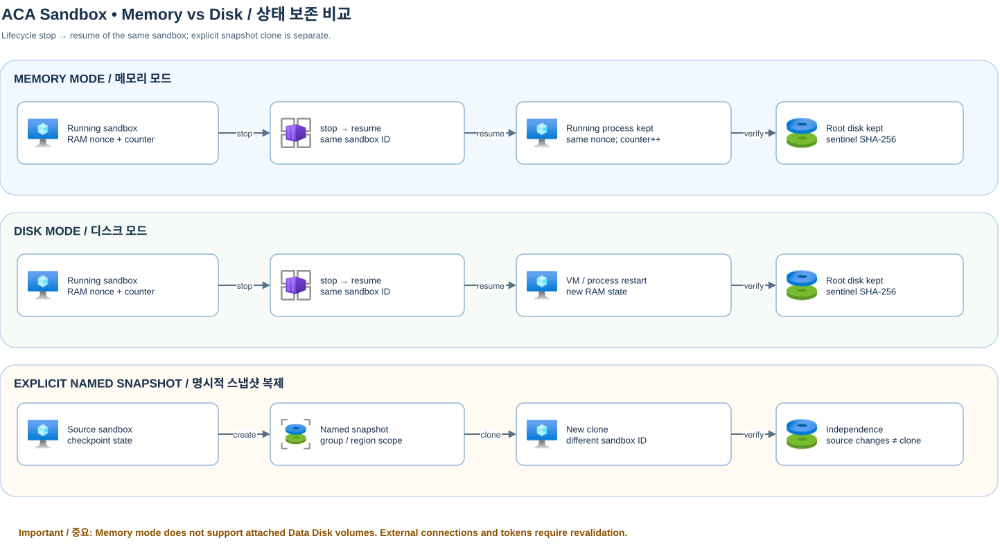

[English](snapshot-comparison-en.md)

# Memory / Disk 상태 비교



[Draw.io 원본](assets/sandbox-memory-vs-disk-snapshot.drawio) · [README](../README.md) · [Sandbox 가이드](sandbox.md)

`examples\sandbox\fixtures\state_worker.py`는 Python 표준 라이브러리만 사용하는
루프백 HTTP 워커다. `start`, `probe`, `increment`, `stop`을 지원한다.
기본 Linux 경로는 `/workspace/demo`, 포트는 `127.0.0.1:18765`다.
공개 포트나 외부 연결은 필요하지 않다.

## 오프라인 실행

```powershell
.\.venv\Scripts\python.exe examples\sandbox\compare_snapshot_modes.py --iterations 3 --format markdown
.\.venv\Scripts\python.exe examples\sandbox\compare_snapshot_modes.py --format json
.\.venv\Scripts\python.exe examples\sandbox\compare_snapshot_modes.py --format csv
.\.venv\Scripts\python.exe -m pytest tests\unit
```

CLI는 기본적으로 오프라인이며 `--live`와 `ENABLE_LIVE_AZURE=true`로 실제 Azure를 사용한다. fake의 지연 시간은 호스트 시뮬레이터 실행 시간이며,
Azure 성능 수치가 아니다. JSON/CSV의 `simulated` 필드로 구분한다.
각 반복은 같은 설정의 새 샌드박스를 사용하며, 모드 순서는 교차한다.

## 증거와 합격 조건

- **설치 도구 증거**: `/usr/local/bin/agent-tool --versions`를 재개 전후 실제 실행한다. git/jq/sqlite3 바이너리·버전, 커스텀 CLI 및 전용 설정 지문이 동일해야 `installed_tool_preserved=true`다. 양 모드 모두 재설치하지 않는다. 디스크 sentinel만 남거나 도구가 실행되지 않으면 실패다.
- **도구 서버**: 샘플 Git/JSON/SQLite 프로젝트의 파일 인덱스를 최초 시작 때 RAM에 구성한다. probe는 루프백 서버 API를 호출하며 인덱스 및 nonce·카운터는 디스크에서 복원하지 않는다.
- 디스크 증거는 `sentinel.txt`의 고정 내용과 SHA-256이다. 최초 쓰기는
  `flush()`와 `os.fsync()`를 완료한다. 재시작은 기존 파일을 덮어쓰지 않는다.
- RAM nonce, 64 KiB 난수 버퍼/체크섬, 프로세스 시작 지문과 카운터는 데몬의
  메모리에만 존재한다. PID 파일, 상태 파일, 데몬 로그로 저장하지 않는다.
  관찰 결과는 호스트에 반환하며 복원 입력으로 보내지 않는다.
- 모든 정상 루프백 요청은 카운터를 증가시킨다. `start`의 최초 응답은 1이다.
- **Memory**: 재시작 없이 디스크 해시, nonce, 버퍼 체크섬, 프로세스 시작 지문이
  같고 카운터가 증가해야 한다. PID 일치만으로는 합격하지 않는다.
- **Disk**: bootstrap 전 디스크 해시가 같고 기존 데몬이 응답하지 않아야 한다.
  명시적 `start` 후 새 nonce/시작 지문과 카운터 1을 확인한다.
  bootstrap이 누락된 sentinel을 새로 만들어도 사전 관찰 실패를 숨기지 않는다.
- 재개 후 별도 파일의 쓰기/읽기도 검증한다. named snapshot/clone API는
  이 실험에서 사용하지 않는다.

## 측정 경계와 실패

| 지표 | 측정 구간 |
| --- | --- |
| `stop_to_stopped_ms` | stop 직전 → Stopped/Suspended 확인 |
| `resume_to_running_ms` | resume 직전 → Running 확인 |
| `first_exec_probe_ms` | Running 확인 직후 → 첫 exec 응답 |
| `worker_ready_ms` | 첫 exec 이후 → RAM/disk probe 및 Disk bootstrap 응답 |

프로비저닝·fixture 전송은 측정에서 제외한다. 중지 유지 시간은 동일하다.
통계는 성공 표본의 평균/p50(중앙값)/p95(nearest-rank)/min/max를 계산한다.
전체·성공·실패 수와 단계별 제외 수를 항상 표시하고, 실패 원시 표본과 부분
측정값도 JSON/CSV에 보존한다. 실행 명령은 자동 재전송하지 않는다.
실패 시에도 이번 실행 소유 샌드박스만 정리하며 삭제 실패는 실패 표본으로
남기고 어댑터의 소유 ID를 보존한다.

## 실제 Azure 연결

README의 Sandbox 설정과 RBAC를 준비하고, 이미지에서 `python3`의 존재를 먼저 확인한다. 라이브 실행은 비용을 발생시킨다. raw 관찰에는 nonce와 파일 해시가 포함되므로 비공개로 보관한다.

```powershell
.\.venv\Scripts\python.exe examples\sandbox\compare_snapshot_modes.py --live --iterations 3 --format json --output-dir .internal\results\comparison
```

기본 반복은 각 모드 1회이며, `--iterations`마다 Memory/Disk 순서를 교차한다. `--format`은 text, json, markdown, csv를 지원하고 `--output-dir`을 지정하면 JSON/CSV/Markdown 세 파일을 저장한다. 이 CLI에는 warm-up, 모드 선택 또는 hold-time 인자가 없다. 실패 표본도 보고하며 삭제 실패 시 private recovery manifest를 확인한다.

## 실제 Azure 연결 전 점검

`SandboxLifecycleComparator(adapter).run(...)`에 명시적으로 활성화된
`AcaSandboxAdapter`를 주입할 수 있다. 기존 설정/인증 계약을 따르고 private
manifest를 지정한다. 동일 이미지/CPU/메모리/리전 설정을 유지해야 한다.
기본 `ubuntu` 이미지에 `python3`가 있다고 가정하지 않는다. 이미지 준비와
Python 존재를 먼저 검증한다. 현재 모듈은 측정 전에 git/jq/sqlite3와 커스텀 CLI·설정을 실제 설치하며 Ubuntu 패키지 저장소 접근이 필요하다.

모드 정책과 auto-delete 비활성화를 재조회하며, Memory 비교에는 볼륨을
연결하지 않는다. backing type을 증명할 수 없는 볼륨도 보수적으로 거부한다.
SDK polling 간격·네트워크를 포함한 호스트 관측값이므로 플랫폼 고유 지연이나
sub-second SLO로 해석하지 않는다. 실험 결과와 적용 범위는 아래에 제시한다.
원시 관찰값은 공개 문서가 아닌 `.internal\results\`에 보관한다.


## 실제 툴체인·인덱스 서버 결과 (2026-11-05)

실제 Azure 6개 표본 모두 통과했다(`simulated=false`). 양 모드에서 git/jq/sqlite3·커스텀 CLI·설정이 재개 후 실행 가능하고 지문도 동일했다. 초기 인덱스는 프로젝트 파일 3개다. Memory는 nonce·버퍼 체크섬·프로세스 시작 지문과 counter 5→6을 유지했다. Disk는 bootstrap 전 서버가 없고 새 지문과 counter 1로 재기동했다. 재개 후 도구 재설치는 없으며 설치는 수명 주기 측정에서 제외했다.

| 모드 | 회차 | 설치 도구 | 디스크 | 메모리 | 재기동 | Stop ms | Resume ms | 첫 exec ms | 서버 준비 ms |
| --- | ---: | --- | --- | --- | --- | ---: | ---: | ---: | ---: |
| Memory | 1 | true | true | true | false | 9106.398 | 1348.855 | 297.033 | 399.850 |
| Disk | 1 | true | true | false | true | 6922.497 | 1452.435 | 213.394 | 936.704 |
| Disk | 2 | true | true | false | true | 6802.469 | 1325.619 | 214.688 | 891.404 |
| Memory | 2 | true | true | true | false | 8900.459 | 1087.710 | 252.034 | 412.084 |
| Memory | 3 | true | true | true | false | 9503.373 | 1284.911 | 224.748 | 451.825 |
| Disk | 3 | true | true | false | true | 6790.159 | 1437.641 | 205.635 | 987.945 |

모드별 표본은 3개뿐이다. SDK polling을 포함한 클라이언트 관측값이며 SLA나 일반적인 성능 우열로 확대하지 않는다.


단계별 성공 표본 집계 (ms; p95는 nearest-rank):

| 모드 | 표본 | 성공 | 실패 | 단계 | 평균 ms | p50 ms | p95 ms | 제외 |
| --- | ---: | ---: | ---: | --- | ---: | ---: | ---: | ---: |
| Memory | 3 | 3 | 0 | stop_to_stopped_ms | 9170.077 | 9106.398 | 9503.373 | 0 |
| Memory | 3 | 3 | 0 | resume_to_running_ms | 1240.492 | 1284.911 | 1348.855 | 0 |
| Memory | 3 | 3 | 0 | first_exec_probe_ms | 257.938 | 252.034 | 297.033 | 0 |
| Memory | 3 | 3 | 0 | worker_ready_ms | 421.253 | 412.084 | 451.825 | 0 |
| Disk | 3 | 3 | 0 | stop_to_stopped_ms | 6838.375 | 6802.469 | 6922.497 | 0 |
| Disk | 3 | 3 | 0 | resume_to_running_ms | 1405.231 | 1437.641 | 1452.435 | 0 |
| Disk | 3 | 3 | 0 | first_exec_probe_ms | 211.239 | 213.394 | 214.688 | 0 |
| Disk | 3 | 3 | 0 | worker_ready_ms | 938.684 | 936.704 | 987.945 | 0 |

## 아키텍처 해석

- **설치 도구와 디스크**: `installed_tool_preserved=true`와 `disk_preserved=true`는 두 모드 모두 유지되는 루트 파일시스템에 `git`, `jq`, `sqlite3`, `agent-tool`과 설정이 설치되기 때문이다. 재개 후 재설치 없이 실행하며 sentinel만으로는 도구 보존을 증명하지 않는다.
- **Memory**: `memory_preserved=true`, `worker_restarted=false`. 기존 루프백 서버와 RAM 인덱스, nonce, 버퍼 체크섬, 프로세스 지문 및 카운터 증가가 연속성을 증명한다. `worker_ready_ms` 평균은 421.253ms다.
- **Disk**: `memory_preserved=false`, `worker_restarted=true`. VM·프로세스 RAM과 캐시 인덱스는 소실되며 명시적 재기동으로 보존된 프로젝트 파일에서 인덱스를 다시 만든다. `worker_ready_ms` 평균은 938.684ms다. PID 재사용은 연속성 증거가 아니다.
- `worker_ready_ms`는 첫 exec 이후의 추가 구간이지 전체 재개 시간이 아니며 Disk에서는 서버 부재 확인·재기동을 포함한다. 모드별 세 표본의 p95는 최댓값이다. polling·네트워크·호스트 비용이 포함되므로 SLA, 일반적 성능 우열 또는 비용 우위를 추론하지 않는다. 프로비저닝은 제외했고 Data Disk를 연결하지 않았으며 새 샌드박스 6개가 모두 통과하고 정리됐다.
